# Kiky's AI Software Factory - Operational Guidelines & Agent Protocol

> **Supreme Commander / Lead Architect:** Kiky (@rizky)  
> **Workspace:** `c:\Users\rizky\Documents\Dev\my-ai-factory`  
> **Architecture Model:** Isolated Context Multi-Agent Software Engineering Team  

---

## 1. Core Principle: Isolated Contexts, Centralized Direction

1. **Context Isolation (Anti-Contamination):**
   - Each engineering specialist runs in an independent Antigravity conversation context (`invoke_subagent` with unique `conversationId`).
   - Engineers never pollute each other's context windows.
   - Each engineer operates within a pristine ~100k+ token smart zone with specialized role prompting and scoped tool permissions.

2. **Kiky as Supreme Commander (Human-in-the-Loop):**
   - No subagent is permitted to merge code, push to git, deploy to VPS, or make major architectural changes without Kiky's explicit review and green light.
   - The primary Antigravity session acts as Kiky's Executive Assistant & Dispatcher, orchestrating the handoffs.

---

## 2. Engineering Team Roster

| Specialist Agent | Subagent Type | Domain & Output Location | Core Deliverables |
| :--- | :--- | :--- | :--- |
| **Product Manager** | `pm_spec` | `docs/factory/01-spec/` | PRD, BRD, User Stories, Gherkin Acceptance Criteria, Scope |
| **Lead UI/UX Designer** | `ux_ui_designer` | `docs/factory/02-design/` | Apple HIG tokens, micro-interactions, spring curves, responsive layouts, anti-slop styling |
| **System Architect** | `system_analyst` | `docs/factory/03-architecture/` | Mermaid ERD, Draw.io schemas, DFD Level 1, API contracts (OpenAPI/Zod), database models |
| **Security Auditor** | `security_auditor` | `docs/factory/04-security/` | Threat models, OWASP Top 10 audits, secret isolation, CORS/CSP header verification |
| **Senior Fullstack Coder**| `fullstack_engineer` | `app/`, `components/`, `lib/` | Type-safe Next.js 15, React 19, Tailwind, API handlers, zero placeholders |
| **QA Test Engineer** | `qa_engineer` | `docs/factory/05-qa/`, `tests/` | Automated test suites (`tests/*.test.mts`), break-ui stress tests, verification evidence |
| **DevOps Sentry** | `devops_sentry` | `docs/factory/06-devops/` | CI/CD GitHub Actions, PM2 process management, Caddy reverse proxy, Open WebUI telemetry |

---

## 3. Workflow Pipeline & Hand-off Protocol

```mermaid
flowchart TD
    Kiky["👤 Kiky (Commander & Lead Architect)"] -->|"Directs / Prompts"| Orch["🤖 Antigravity Orchestrator"]
    Orch -->|"Dispatches in New Conversation"| PM["📋 @pm_spec (Conversation #1)"]
    PM -->|"Submits PRD & Stories"| Gate1{"🛡️ Kiky Approval Gate 1"}
    
    Gate1 -->|"Approved"| UX["🎨 @ux_ui_designer (Conversation #2)"]
    Gate1 -->|"Revision Needed"| PM
    
    UX -->|"Submits UI Tokens & Layout"| Gate2{"🛡️ Kiky Approval Gate 2"}
    Gate2 -->|"Approved"| SA["📐 @system_analyst (Conversation #3)"]
    Gate2 -->|"Revision Needed"| UX
    
    SA -->|"Submits ERD & API Contracts"| Gate3{"🛡️ Kiky Approval Gate 3"}
    Gate3 -->|"Approved"| Sec["🔒 @security_auditor (Conversation #4)"]
    Gate3 -->|"Revision Needed"| SA
    
    Sec -->|"Submits Security Hardening"| Gate4{"🛡️ Kiky Approval Gate 4"}
    Gate4 -->|"Approved"| Dev["💻 @fullstack_engineer (Conversation #5)"]
    Gate4 -->|"Revision Needed"| Sec
    
    Dev -->|"Builds & Compiles Code"| QA["🧪 @qa_engineer (Conversation #6)"]
    QA -->|"Submits Test Evidence (100% Pass)"| Gate5{"🛡️ Kiky Final Review"}
    
    Gate5 -->|"Approved for Release"| DevOps["🚀 @devops_sentry (Conversation #7)"]
    DevOps -->|"Deploys to VPS / PM2"| Production["🌐 Live Production (:8450)"]
```

---

## 4. Master Rules

1. **Blueprint as Single Source of Truth:** Code must always conform to `docs/factory/` blueprints. If code needs to diverge, the blueprint must be updated first with Kiky's approval.
2. **Deterministic Quality & Zero Hallucination:** No placeholder code (`// TODO: implement later`), no mock shortcuts in production paths, no `any` type escapes.
3. **Evidence Before Assertions:** QA must show actual terminal test outputs with zero failures before a feature can be marked ready.
4. **Secret Isolation:** Zero hardcoded API keys, passwords, or raw VPS IP addresses in git-tracked code. Environment variables only via `.env.local` / GitHub Secrets.

---

## 5. Agent Skills & Engineering Setup

### Issue Tracker
GitHub Issues on `https://github.com/rizkyaryendigumilang/my-ai-factory` via `gh`. See `docs/agents/issue-tracker.md`.

### Triage Labels
Five canonical triage labels (`needs-triage`, `needs-info`, `ready-for-agent`, `ready-for-human`, `wontfix`). See `docs/agents/triage-labels.md`.

### Domain Docs
Single-context domain model in `GLOSSARY.md` and ADRs in `docs/adr/`. See `docs/agents/domain.md`.
